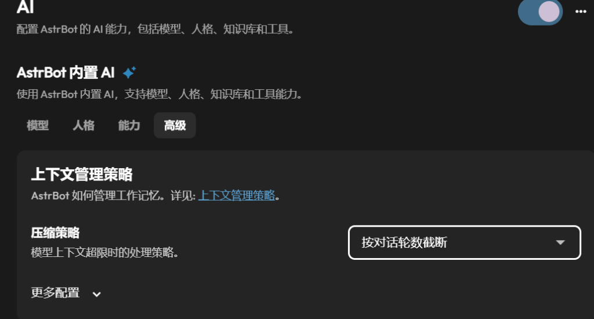

  
  <h1>提高缓存命中 (astrbot_plugin_cache_optimizer)</h1>
  
减少对话上下文的频繁滑动，提升 DeepSeek、Kimi 等大模型的前缀缓存（Prefix Cache）命中率，降低 API 费用与响应延迟。

---

## 插件有什么用？

目前许多主流大模型（如 DeepSeek、Kimi、Claude 等）都支持**提示词前缀缓存（Prefix Cache）**机制：
当发给模型的历史上下文开头内容与先前的请求一致时，服务商会复用已有的计算缓存，**命中缓存的输入计费远低于未命中时的常规计费，同时因无需重复计算历史上下文，首字生成延迟也会有所降低**。

但在默认多轮对话中，缓存往往很难持续命中：
- **会话满额后每轮都在滑动**：当对话达到最大轮数后，框架默认每聊一句就挤掉最老的一句（滑动窗口）。由于历史文本的开头位置每轮都在往前挪动，导致整段多轮对话无法被模型识别为相同的缓存前缀，造成持续穿透与重复计费。

本插件在请求发给大模型前进行阶梯式历史整理，消除这一不必要的变动，帮助模型持续复用缓存。

---

## 工作原理

1. **阶梯式历史裁剪（积攒一批再一次性清理）**
   - 严格按合法的普通用户发言（`role == "user"`，排除工具调用与 `_no_save` 预设对话等特殊结构）精准计数。
   - 设定保留轮数 $L$（默认 10 轮）与步长 $S$（默认 6 轮）。
   - 在步长累积期间，发给模型的历史起点完全保持固定，前序多轮历史能连续稳定命中缓存；
   - 当历史中的合法 User 消息数达到 $L + S$（即当前处于第 $L + S + 1$ 轮对话发车前）时触发裁剪，一次性修剪至保留最近 $L$ 轮历史；
   - **持久化特性**：裁剪后的结果随 AstrBot 正常保存流程持久化写回会话数据库，保持内存与数据库完全一致。
2. **严格事务边界对齐与预设前缀保护（防止接口报错与断裂）**
   - 裁剪起点锁定在完整 User 消息边界，完整保留该轮次后续关联的全部 Assistant 与 Tool 调用链路（Function Calling），绝不从工具事务中间截断；
   - 严格排除带有 `_no_save` 标记的 Persona 预设情景对话虚占轮数，并在切片时完整保留开头的预设前缀，确保裁剪轮人设不丢且模型前缀哈希持续稳定。
3. **真实账单级 Token 统计与实时配置诊断**
   - 直接监听大模型响应事件，读取 DeepSeek 等服务商原生返回的 `usage.input_cached`（命中 Token）与 `usage.input_other`（未命中 Token）；
   - 计算加权真实缓存命中率，数据完全真实，杜绝本地猜测与估算；
   - 实时诊断 AstrBot 原生 `max_turns` 与溢出策略冲突，保障插件正常接管。

---

## 配置说明

在 AstrBot Web 管理面板的插件配置中可直接修改：

| 配置项 | 默认值 | 作用说明 |
| :--- | :--- | :--- |
| **开启缓存保活 (`enabled`)** | `true` | 插件总开关。开启后以阶梯式分块裁剪代替原生逐轮淘汰，裁剪结果随正常流程持久化到会话数据库 |
| **裁剪后保留轮数 (`low_watermark_turns`)** | `10` | 历史消息触发裁剪时，保留最近多少轮合法 User 对话。默认保留 10 轮（至少为 1 轮） |
| **清理步长 (`step_turns`)** | `6` | 多聊多少轮才集中修剪一次。当历史中的合法 User 消息数达到 L + S 轮（当前为第 L + S + 1 轮）时触发裁剪。默认 6 轮（至少为 1 轮） |
| **输出调试日志 (`debug_log`)** | `false` | 在后台终端打印每次请求的保留轮数与切片细节，日常使用建议关闭 |

> [!IMPORTANT]
> ### 关键配置指引：务必将原生「压缩策略」选为「按对话轮数截断」
> AstrBot 原生默认的溢出策略为 `llm_compress`（AI 摘要压缩）。当上下文较长时，框架可能调用模型重写历史为一段前情提要，导致前缀缓存被彻底粉碎。
> 
> **强烈建议按以下路径调整**：
> 1. 打开 WebUI 导航栏的 **「AI」** $\rightarrow$ **「AstrBot 内置 AI」**；
> 2. 切换到 **「高级」** 标签页 $\rightarrow$ 找到 **「上下文管理策略」**；
> 3. 将 **「压缩策略」** 下拉框切换为 **「按对话轮数截断」**（即 `truncate_by_turns`）并保存。
> 
> 

>   
> 

> 
> *(注：同时建议在该界面的更多配置中，将最大上下文轮数 `max_turns` 设置为 `-1` 或调大，交由本插件进行稳定的阶梯分块裁剪)*

---

## 管理员指令

- `/cache_opt`：查看当前插件的运行指标（全局处理次数、裁剪触发次数、配置健康自检诊断、大模型服务端返回的真实缓存命中 Token 统计与加权命中率）。仅管理员可用。
  - *注：该统计为每次请求最终发车的 LLM 响应统计，不宣称覆盖所有 Agent 中间工具调用轮次；累计请求为全局处理总计，裁剪以单会话 User 深度为准。*

---

## 🛠️ 安装与卸载

- **安装**：将本插件目录放置于 AstrBot 的 `data/plugins/` 目录下，重启 AstrBot 或在 WebUI 重载插件即可自动生效。
- **卸载**：直接从插件列表停用或删除插件目录。

---

## 🤖 AI 编程声明

- 本项目由人类开发者提出需求与架构规范，深度协同 **Google DeepMind Antigravity (Gemini)** 结对编写完成；
- 所有核心逻辑、阶梯裁剪边界、Persona 预设对话保留与角色对齐机制均通过针对性本地单元测试，测试用例随仓库包含在 [tests/test_optimizer.py](https://github.com/R0smonti3/astrbot_plugin_cache_optimizer/blob/main/tests/test_optimizer.py) 中供复核。

---

## 📄 开源协议

本项目基于 [MIT License](https://github.com/R0smonti3/astrbot_plugin_cache_optimizer/blob/main/LICENSE) 协议开源。
您可以自由使用、修改和分发，但请保留原作者版权声明及许可声明。
